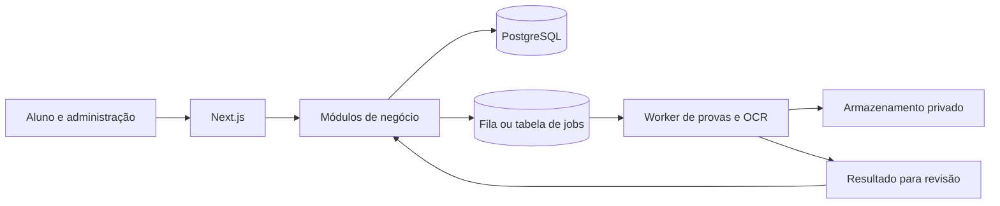

# Análise técnica e plano de evolução

Análise de 24/09/2026 sobre o commit `c4f7b90`, clonado de UaiSilvaz/EstudAkiVestibulares. A inspeção combinou leitura de código, banco local novo, verificações automatizadas e navegação no Edge. Não houve acesso ao ambiente de produção.

**Atualização de execução:** após esta análise, o usuário solicitou a interface EstudAki original. A aplicação agora roda na branch local `estudaki-original`, commit `ce294d9`, anterior à mudança para Silva Educacional. Este relatório permanece como registro da análise do commit indicado acima; referências à aparência e aos testes de `tracks` são específicas daquela revisão. Consulte [EXECUCAO_LOCAL.md](EXECUCAO_LOCAL.md) para o estado atual.

## Recomendação

Evoluir primeiro para um **monólito modular**: uma aplicação publicada como hoje, com responsabilidades e interfaces claras. Organizar o trabalho em pequenos projetos com entregas verificáveis. Extrair o processamento de provas para um worker quando o fluxo de jobs estiver definido. Deixar a separação dos demais serviços condicionada a necessidade de escala, disponibilidade ou equipes independentes.

Uma pasta separada é um módulo; um pacote reutilizável é uma unidade de código; um microserviço tem execução, implantação e responsabilidade pelos dados independentes. Separar pastas ou criar várias APIs sobre as mesmas tabelas não resolve o acoplamento.

Essa escolha considera o código atual, não métricas de tráfego: não foram disponibilizados volume de usuários, custos, tamanho da equipe ou tempos de produção. Microserviços acrescentam comunicação de rede, consistência distribuída e operação. Referência: [Microsoft — arquiteturas de aplicações web](https://learn.microsoft.com/en-us/dotnet/architecture/modern-web-apps-azure/common-web-application-architectures).

## O que existe hoje

| Parte | Estado observado |
| --- | --- |
| Aplicação | Next.js 16.3.0, React 19.2.4, TypeScript, App Router; interface e backend no mesmo projeto |
| Dados | Prisma 6.19.3, PostgreSQL, 89 modelos e 20 migrações |
| Superfície | 70 arquivos de página e 83 Route Handlers |
| Visual | Tailwind, CSS próprio, Framer Motion, GSAP, componentes e design system |
| Produto | Questões, provas, cursos, preparações, plano de estudo, progresso, comunidade, materiais, compras e administração |
| Processamento | Scripts TypeScript/Python, extração PDF, OCR e importação/revisão de questões |
| Serviços de servidor | `src/server` contém principalmente segurança; grande parte das regras continua em `src/lib` e nas rotas |

Há fundamentos úteis: migrações versionadas, cookies assinados, sessões persistidas, permissões, DTOs para questões, fluxo de revisão editorial, testes de regras e separação inicial dos motores de aprendizagem. A extração de domínios pode aproveitar isso.

`docs/ARCHITECTURE.md` já descreve uma direção modular. A principal tarefa é fazer o código seguir essa direção. Planos existentes, como `ARCHITECTURE_PLAN.md`, descrevem também intenção; não devem ser tratados como comprovação de que todos os fluxos estão concluídos.

## Problemas a priorizar

### P0 — Dependências antes de publicar

`npm audit --omit=dev` retornou 6 entradas: 1 crítica, 4 altas e 1 moderada. A contagem inclui dependências transitivas, não equivale a seis falhas independentes comprovadamente exploráveis no produto.

- Next.js 16.3.0 está na faixa afetada de avisos de execução remota em servidores Windows e no processamento de AVIF. Os avisos consultados indicam correção em 16.3.3. Ver [aviso Windows](https://github.com/vercel/next.js/security/advisories/GHSA-p293-qw3h-jr36) e [aviso AVIF](https://github.com/vercel/next.js/security/advisories/GHSA-2xp9-vwfh-vxw4).
- Sharp 0.35.3 aparece em aviso corrigido em 0.35.4: [aviso do mantenedor](https://github.com/lovell/sharp/security/advisories/GHSA-rgj7-g3m4-5g8c).
- Revisar separadamente a árvore Prisma e as dependências transitivas. A sugestão automática do npm para Prisma envolve outra versão; não aplicar `audit fix --force` sem avaliar compatibilidade.

Fazer uma atualização controlada, regenerar o lockfile e executar build, testes e fluxos de imagem/autenticação. As versões foram mantidas nesta execução para avaliar o projeto atual. O servidor local está limitado a `127.0.0.1`.

### P1 — Banco reproduzível

As 20 migrações aplicam com sucesso, mas o banco resultante diverge do schema. Comando de diagnóstico executado:

```powershell
npx prisma migrate diff --from-schema-datasource prisma/schema.prisma --to-schema-datamodel prisma/schema.prisma --exit-code
```

Diferenças encontradas:

- `UserProduct.revokedAt` existe no schema e falta no banco migrado.
- `Product.materialId` é opcional no schema e obrigatório no banco; a relação também difere.
- O valor padrão de `User.league` difere.
- Índices de `Achievement` e `UserAchievement` presentes no banco não constam do schema.

Criar uma migração revisada para alinhar a intenção de cada diferença. Não remover índices automaticamente: verificar se foram intencionais. Testar tanto banco vazio quanto atualização de uma cópia de desenvolvimento. Nenhum `db push`, reset ou ajuste silencioso dessas diferenças foi executado.

### P1 — Compras e concessões de acesso

Em [webhook Hotmart](../src/app/api/webhooks/hotmart/route.ts):

- Por volta da linha 216, qualquer evento já registrado retorna como duplicado, inclusive `ERROR` ou `PENDING`. Uma falha após registrar o evento pode impedir sua recuperação em uma nova entrega.
- As gravações de evento, compra e acesso são separadas. Uma interrupção deixa estado parcial; entregas concorrentes também precisam de tratamento explícito.
- `ensureUser`, por volta da linha 143, força `role: STUDENT` também na atualização. Um comprador já cadastrado como professor/administrador pode perder seu papel.
- Aprovação e estorno alteram `UserProduct`, enquanto cursos consultam `Entitlement` em [learning.ts](../src/lib/courses/learning.ts). Falta demonstrar um fluxo integrado de pagamento real até acesso ao curso.
- Um estorno remove o acesso do par usuário/produto sem verificar outra compra válida. Modelar concessões por origem/compra evita revogar direitos independentes.

Primeiro projeto funcional recomendado: corrigir esse fluxo com transação onde aplicável, estados de processamento recuperáveis, chave de evento estável e testes de duplicação, falha, concorrência, estorno e múltiplas concessões. Depois avaliar fila/outbox. Estes achados vieram de leitura de código; nenhum pagamento real foi efetuado.

### P1 — Uploads e redações

[A rota de redações](../src/app/api/essays/evaluate/route.ts) grava imagens em `public/uploads/essays`. O nome aleatório não substitui autorização de leitura; o armazenamento também depende do disco local da aplicação.

Mover para armazenamento privado, validar o conteúdo real do arquivo, limitar o corpo antes de processá-lo e servir por acesso autorizado ou URL temporária. Reaproveitar os utilitários de segurança já existentes. Em [essay-evaluator.ts](../src/lib/essay-evaluator.ts), a avaliação é heurística, baseada em características do texto. Apresentá-la claramente como estimativa, com critérios e limites; não presumir uma correção pedagógica validada.

### P2 — Separação das regras

Exemplos de pontos concentrados: [question-practice.tsx](../src/components/question-practice.tsx), [exam-workspace.tsx](../src/components/exam-workspace.tsx), [courses/learning.ts](../src/lib/courses/learning.ts) e [API administrativa de questões](../src/app/api/admin/questions/route.ts).

Separar por responsabilidade, mantendo as URLs atuais:

- Rota: autenticação, validação, chamada de serviço e resposta.
- Serviço: caso de uso e regra de negócio.
- Repositório: consultas Prisma, filtros e paginação.
- Contratos: entradas e respostas públicas, sem expor o modelo inteiro do banco.
- Interface: componentes por ação e hooks para estado/interação.

Começar por compras ou questões. Não mover todos os arquivos de uma vez. Acrescentar restrições de imports no lint e `server-only` onde necessário para sustentar os limites.

### P2 — Processamento fora da requisição

[A extração de provas](../src/app/api/admin/provas-antigas/[id]/processar/route.ts) chama processamento de arquivos pelo fluxo HTTP; [a extração de gabaritos](../src/app/api/admin/official-files/[id]/extract/route.ts) também executa trabalho de PDF. Há ainda pipelines Python grandes em `scripts/enem`.

Criar jobs persistidos com estados `PENDING`, `RUNNING`, `SUCCEEDED`, `FAILED`, tentativas, progresso e erro. A API cria o job e retorna seu identificador; um worker processa o documento. Usar idempotência por arquivo/hash e versão do pipeline, timeout, concorrência limitada e revisão humana antes da publicação. Credenciais de IA, quando configuradas, exigem controle de custo e rastreamento por job.

### P2 — Verificações e operação

- Não há workflow de CI versionado em `.github` neste checkout. Criar pipeline com instalação pelo lockfile, geração Prisma/Next, lint, tipos, testes e build.
- Os testes do inventário ENEM dependem de `data/provas/enem/INVENTARIO_OFICIAL_ENEM_2009_2025.md`, ausente e dentro de uma pasta ignorada. Criar uma fixture mínima versionada para teste unitário; manter a validação do corpus completo como teste de integração separado.
- `npm run typecheck` falha em clone limpo antes da geração de tipos Next (`RouteContext`). Executar `next typegen` antes do TypeScript no fluxo de verificação.
- `npm run db:seed` não carregou `.env` nesta máquina. Documentar/carregar explicitamente o ambiente. Os slugs antigos `policial` e `militar` também quebravam o seed; foram corrigidos para `policia-civil` e `militares` neste checkout.
- [Rate limiting](../src/server/security/rate-limit.ts) usa `Map` em memória. Ao ter várias instâncias, adotar armazenamento compartilhado ou limitação no gateway, conforme a infraestrutura.
- Medir latência por rota, tempo de consultas, falhas de login/webhook, idade dos jobs e falhas de importação. Não decidir escala apenas pelo número de arquivos.

## Divisão em microprojetos

Um microprojeto aqui é uma entrega pequena, com objetivo, responsável e critério de conclusão; pode continuar no mesmo repositório.

| Ordem | Projeto | Entrega | Critério de conclusão |
| --- | --- | --- | --- |
| 1 | Fundação e execução | Dependências corrigidas, seed, migrações, CI e documentação | Clone limpo sobe e verificações passam sem arquivos pessoais |
| 2 | Compras e acesso | Hotmart, pedidos e concessões consistentes | Aprovação libera; repetição não duplica; estorno revoga só a origem correta |
| 3 | Questões e prática | Serviço de questões, filtros, resposta, tentativas e revisão | Gabarito protegido; tentativa persiste e atualiza progresso sem duplicar recompensa |
| 4 | Conteúdo e aprendizagem | Cursos, aulas, preparações e progresso | Aula compartilhada mantém progresso e acesso correto entre preparações |
| 5 | Importação assíncrona | Worker de PDFs/OCR, jobs e painel de revisão | Processamento retoma após falha sem duplicar questões ou publicar sem revisão |
| 6 | Experiência do aluno | Fluxo estudar → responder → revisar → acompanhar | Fluxo principal testado em celular e desktop com dados reais ou estados vazios |

Limitar trabalho simultâneo. Finalizar a fundação e o fluxo de acesso antes de ampliar as áreas de ensino.

## Estrutura proposta para a próxima etapa

```text
src/
  app/                      # páginas e fronteira HTTP
  components/               # interface compartilhada
  server/
    modules/
      identity/             # usuários, sessões e papéis
      questions/            # questões, tentativas e revisão editorial
      learning/             # aulas, progresso e plano
      commerce/             # compras e concessões
      ingestion/            # jobs, fontes e publicação
    integrations/           # storage, Hotmart e provedores externos
    security/
```

Cada módulo deve expor uma interface pública pequena. O banco pode continuar único nesta fase, com propriedade lógica das tabelas. Evitar que todos os módulos escrevam livremente nas tabelas uns dos outros.

Quando houver benefício concreto em compartilhar pacotes e executar o worker separado, considerar monorepo:

```text
apps/web/                   # Next.js e backend para a interface
apps/ingestion-worker/      # execução de jobs TypeScript/Python
packages/contracts/        # contratos e validação compartilhados
packages/ui/               # componentes usados por mais de uma aplicação
packages/database/         # Prisma do núcleo durante a transição
```

Não compartilhar o cliente Prisma inteiro como interface entre futuros microserviços. Quando um domínio ganhar banco próprio, acessá-lo por contrato e eventos; migrar ownership e dados gradualmente. Não criar uma aplicação administrativa separada até existir necessidade de deploy ou equipe própria.



O diagrama é uma proposta, não a infraestrutura já instalada. Um worker pode começar usando PostgreSQL para jobs, desde que tenha reserva atômica, expiração da reserva e recuperação; uma fila externa deve ser escolhida conforme volume e operação.

## Quando extrair microserviços

O primeiro candidato é importação/OCR: trabalho demorado, dependências específicas e escala diferente das páginas. IA pode usar a mesma base de jobs inicialmente. Notificações vêm depois, caso haja demanda. Manter identidade, compras e aprendizagem próximos enquanto suas transações e contratos ainda estão sendo estabilizados.

Gatilhos úteis: processamento compromete a latência web; cargas exigem escalas distintas; equipe precisa publicar independentemente; falhas de um domínio precisam de isolamento. Antes da extração, exigir contrato versionado, monitoramento, repetição segura, responsável pelos dados e plano de migração. Não há evidência nesta análise para introduzir Kubernetes ou vários bancos imediatamente.

## Melhorias na experiência

Observação das capturas desktop e celular do painel, não uma auditoria completa de acessibilidade:

- A hierarquia visual e o painel responsivo já oferecem uma base aproveitável. O painel de 390 px não teve overflow horizontal.
- O painel repete ações semelhantes em “Sua rota de hoje”, “Seu foco de hoje” e “Plano de hoje”. Dar destaque a uma próxima ação e deixar detalhes para expansão.
- Na demonstração, disponibilidade de 1h30 aparece junto de plano de 2h, com duas atividades de flashcards de Matemática. Investigar orçamento de tempo e deduplicação do planejador.
- O celular exige bastante rolagem; priorizar próxima tarefa, meta diária e retomada antes dos gráficos.
- O README chama o produto de EstudAki, enquanto a interface mostra Silva Educacional. Definir a relação entre essas marcas e padronizar textos, metadados e documentação.
- Adicionar verificações de teclado, foco, contraste, movimento reduzido e navegação em conexão lenta em uma etapa específica.

## Resultado das verificações

| Verificação | Resultado |
| --- | --- |
| Instalação `npm ci` e geração Prisma | Passaram |
| Migrações em PostgreSQL local novo | 20 aplicadas |
| Seed | Passou com `.env` carregado explicitamente e correção de dois slugs |
| Lint | 0 erros; 3 avisos de imagens em componentes Reactbits |
| Tipos | Passaram após `next typegen`; clone limpo falhava por falta de `RouteContext` |
| Build de produção | Passou |
| `npm test` | 41 passaram; 2 falharam por inventário ENEM ausente |
| `test:tracks` | 3 passaram |
| `enem:corpus:test` | 2 passaram |
| Diferença schema/banco | Detectada; pendente de migração revisada |
| Browser | Landing, login, dashboard, questões, cursos, preparações e perfil responderam; nenhum erro JavaScript capturado na navegação testada |
| Autorização | Login via API funcionou para aluno e admin; `/api/admin/users` respondeu 403 para aluno e 200 para admin |

O probe `/api/questions` retornou 404: esse endpoint de listagem não existe; a página `/questions` respondeu 200. Isso não foi tratado como falha do fluxo da tela.

Limites: não foram validados checkout/webhooks reais, serviços externos, corpus completo, reprodução de todas as mídias, carga, todas as 70 páginas ou todos os fluxos de gravação. As evidências locais estão em `.codex`, ignorada pelo Git. Instruções de acesso e retomada em [EXECUCAO_LOCAL.md](EXECUCAO_LOCAL.md).
